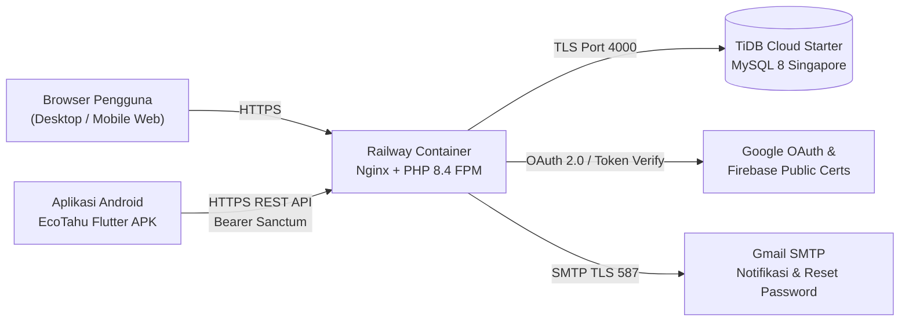

# Panduan Pengembang (Developer README) — EcoTahu

Dokumentasi teknis lengkap untuk arsitektur, pengembangan lokal, keamanan, deployment cloud, dan perilisan aplikasi Android **EcoTahu**.

---

## 1. Akses Cepat Produksi & Repositori

| Komponen | URL / Lokasi | Keterangan |
| :--- | :--- | :--- |
| **Website & REST API Live** | https://eco-tahu-production.up.railway.app | HTTPS aktif (Railway Docker: Nginx + PHP 8.4 FPM) |
| **Health Check Server** | https://eco-tahu-production.up.railway.app/up | Endpoint health check bawaan Laravel 13 |
| **Repositori Web & API** | https://github.com/gsibyte-ops/eco-tahu | Laravel 13, Blade, Tailwind CSS, Vite, Sanctum, Socialite |
| **Repositori Mobile** | https://github.com/gsibyte-ops/eco-tahu-mobile | Flutter Android + Firebase Auth + Google Sign-In |
| **Rilis APK Android** | https://github.com/gsibyte-ops/eco-tahu-mobile/releases/tag/v1.0.0 | APK Release signed, R8 minified, Dart obfuscated |
| **Database Cloud** | TiDB Cloud Starter (`ap-southeast-1` Singapore) | MySQL 8 compatible, koneksi terenkripsi TLS |

---

## 2. Arsitektur Sistem



### Stack Teknologi
- **Backend & Web:** PHP 8.4, Laravel 13, Eloquent ORM, Laravel Sanctum (API Auth), Laravel Socialite (Google OAuth Web), Blade + Alpine.js + Tailwind CSS v3 + Vite 8, DomPDF.
- **Mobile Android:** Flutter (Dart SDK `>=3.0.0 <4.0.0`), `provider`, `http`, `flutter_secure_storage` (AES-256 Android Keystore), `firebase_auth`, `google_sign_in`, `flutter_map` + `geolocator`, `video_player`.
- **Produksi & Cloud (0 Kartu Kredit):**
  - **App Server:** Railway (Docker multi-stage build: `node:22-alpine` → `php:8.4-fpm` + `nginx`).
  - **Database:** TiDB Cloud Starter (MySQL 8 compatible, region Singapore).
  - **Distribusi APK:** GitHub Releases CDN (`--split-per-abi`).

---

## 3. Menjalankan di Lingkungan Lokal

### A. Web & API (`eco-tahu`)
**Prasyarat:** PHP `>= 8.4` (wajib 8.4+ karena `config/database.php` memakai `Pdo\Mysql`), Composer 2, Node.js `>= 20`, MySQL `8.4`.

```bash
git clone https://github.com/gsibyte-ops/eco-tahu.git
cd eco-tahu

composer install
npm install
cp .env.example .env
php artisan key:generate
```

1. Buat database lokal `db_eco_tahu` di MySQL dan sesuaikan `DB_*`, `MAIL_*`, serta `GOOGLE_*` di `.env`.
2. Jalankan migrasi, seeder data awal, symlink storage, dan build asset:
   ```bash
   php artisan migrate --seed
   php artisan storage:link
   npm run build
   ```
3. Jalankan server lokal:
   ```bash
   php artisan serve --host=127.0.0.1 --port=8000
   ```
   Akses lokal: `http://127.0.0.1:8000` (atau `http://localhost:8000` untuk uji Google OAuth lokal).

### B. Aplikasi Mobile (`eco-tahu-mobile`)
**Prasyarat:** Flutter SDK, Android SDK / JDK 21.

```bash
git clone https://github.com/gsibyte-ops/eco-tahu-mobile.git
cd eco-tahu-mobile
flutter pub get
```

- **Default produksi:** `lib/config/app_config.dart` sudah diarahkan ke `https://eco-tahu-production.up.railway.app`.
- **Override saat testing lokal (emulator Android):**
  ```bash
  flutter run --dart-define=API_HOST=http://10.0.2.2:8000
  ```

---

## 4. Konfigurasi Produksi & Environment Variables (Railway)

Semua rahasia disimpan di tab **Variables** Railway (bukan di Git). Variabel inti yang harus terpasang:

| Variabel | Nilai / Contoh | Keterangan |
| :--- | :--- | :--- |
| `PORT` | `7860` | Port internal container Nginx ↔ Railway Public Networking |
| `APP_ENV` / `APP_DEBUG` | `production` / `false` | Wajib `false` di produksi agar stack trace tidak bocor |
| `APP_KEY` | `base64:...` | Kunci enkripsi sesi & cookie Laravel |
| `APP_URL` | `https://eco-tahu-production.up.railway.app` | Memicu `URL::forceScheme('https')` dan cookie `Secure` otomatis |
| `DB_CONNECTION` | `mysql` | Driver PDO MySQL |
| `DB_HOST` / `DB_PORT` | `gateway01.ap-southeast-1.prod.aws.tidbcloud.com` / `4000` | Endpoint TiDB Cloud Singapore |
| `DB_DATABASE` | `test` | Nama database aktif di TiDB Cloud |
| `DB_USERNAME` / `DB_PASSWORD` | *(dari konsol TiDB Cloud)* | Simpan hanya di Railway Variables |
| `MYSQL_ATTR_SSL_CA` | `/etc/ssl/certs/ca-certificates.crt` | Sertifikat CA sistem Debian untuk koneksi TLS TiDB Cloud |
| `SESSION_DRIVER` / `CACHE_STORE` | `database` / `database` | Aman untuk container stateless |
| `SANCTUM_EXPIRATION` | `43200` *(default 30 hari)* | Masa berlaku token Bearer API mobile (menit) |
| `MAIL_*` | `smtp.gmail.com` / `587` / `tls` | SMTP Gmail App Password untuk email reset password |
| `GOOGLE_CLIENT_ID` / `SECRET` | *(dari Google Cloud Console)* | OAuth 2.0 Web Client (`EcoTahu Web`) |
| `GOOGLE_REDIRECT_URI` | `https://eco-tahu-production.up.railway.app/auth/google/callback` | Wajib terdaftar di Google Cloud Console |

> [!NOTE]
> **Penyimpanan File pada Container Stateless:** File gambar katalog awal (`public/images/seed/*`) otomatis disalin ke `storage/app/public/` setiap container boot oleh `docker/entrypoint.sh`. Untuk unggahan user baru (foto profil, bukti transfer, media ulasan) yang bersifat permanen jangka panjang di masa depan, disarankan menambahkan Railway Volume atau Object Storage S3/R2.

---

## 5. Alur Deployment & Rilis

### A. Update Website & REST API ke Railway
1. Commit dan push perubahan ke branch `main` di `gsibyte-ops/eco-tahu`:
   ```bash
   git add .
   git commit -m "feat: deskripsi perubahan"
   git push origin main
   ```
2. Jika auto-deploy GitHub tidak aktif pada akun Railway, buka service `eco-tahu` di Railway → **Settings → Source → Check for updates** → klik **Deploy**.
3. `docker/entrypoint.sh` akan otomatis menjalankan:
   - Sinkronisasi aset seed ke `storage/app/public/` & `php artisan storage:link`
   - `config:cache`, `route:cache`, `view:cache`
   - `php artisan migrate --force`
   - Seeding awal otomatis **hanya jika** tabel `users` masih `0` baris
   - Menjalankan `php-fpm` + `nginx` pada port `7860`

### B. Build & Rilis APK Android Baru
Pastikan file `android/key.properties` dan keystore `.jks` tersedia di lokal (file ini sengaja masuk `.gitignore` agar tidak pernah bocor ke GitHub).

```bash
cd eco-tahu-mobile
flutter analyze lib/
flutter build apk --release --split-per-abi \
  --obfuscate \
  --split-debug-info=build/app/outputs/symbols \
  --dart-define=API_HOST=https://eco-tahu-production.up.railway.app
```

Output siap rilis ada di `build/app/outputs/flutter-apk/`:
- `app-arm64-v8a-release.apk` (HP Android modern 64-bit, ~22 MB)
- `app-armeabi-v7a-release.apk` (HP Android lawas 32-bit, ~20 MB)

Upload kedua file tersebut ke **GitHub Releases** pada repo `gsibyte-ops/eco-tahu-mobile` bersama checksum SHA-256.

---

## 6. Ringkasan Kontrol Keamanan yang Sudah Diterapkan

| Lapisan | Implementasi Keamanan |
| :--- | :--- |
| **Password & Hashing** | Bcrypt 12 rounds (`'password' => 'hashed'`), minimal 8 karakter, pencabutan token Sanctum lama otomatis saat ganti/reset password. |
| **OAuth & Reset Password** | `/api/auth/google` memverifikasi token secara kriptografis (`id_token`, `access_token` Google, atau RS256 Firebase JWT ke sertifikat publik Google) dan memblokir auto-link akun admin. `/api/forgot-password` tidak pernah mengembalikan token ke response JSON (hanya lewat email) + pesan generik anti *email enumeration*. |
| **Proteksi Brute Force & Sesi** | Rate limit (`throttle`) pada login, register, forgot-password, dan reset-password (Web & API). Cookie sesi otomatis `Secure`, `HttpOnly`, `SameSite=Lax` di HTTPS; `session()->regenerate()` setelah login; token Sanctum kedaluwarsa 30 hari. |
| **Integritas Transaksi & IDOR** | Kalkulasi harga, ongkir Haversine, diskon promo, dan pengurangan stok dilakukan otoritatif di server dalam `DB::transaction` + `lockForUpdate()`. Endpoint pesanan/ulasan/notifikasi memvalidasi kepemilikan `user_id`. |
| **Web Server & Upload** | Nginx memakai `server_tokens off`, HSTS, `X-Frame-Options: SAMEORIGIN`, `X-Content-Type-Options: nosniff`, `Referrer-Policy`, `Permissions-Policy`, dan blokir eksekusi `.php/.phtml/.phar` di `/storage` & `/files`. `MediaGuard` memeriksa *magic bytes* asli dan `FileProxyController` menerapkan penjagaan `realpath()` serta memblokir `.svg` inline. Export CSV disanitasi terhadap *CSV Formula Injection*. |
| **Keamanan Aplikasi Android** | Token disimpan di **Android Keystore AES-256** (`flutter_secure_storage`), logout mencabut token di server + menghapus cache profil lokal, `allowBackup="false"`, **OWASP MASVS HTTPS-only** (`network_security_config.xml`), R8 minification, Dart `--obfuscate`, dan release keystore signing. |

---

## 7. Checklist Menyambung Custom Domain Nanti (Saat Student Pack Aktif)
1. Klaim domain gratis `.me` (Namecheap) atau `.live` (Name.com) di `education.github.com/pack`.
2. Di Railway → service `eco-tahu` → **Settings → Networking → + Custom Domain** → masukkan domain → tambahkan CNAME/A record yang diberikan Railway ke DNS domain.
3. Update variabel Railway `APP_URL` dan `GOOGLE_REDIRECT_URI` ke `https://<domain-baru>`.
4. Tambahkan `https://<domain-baru>` & `https://<domain-baru>/auth/google/callback` di Google Cloud Console OAuth (`EcoTahu Web`).
5. Rebuild APK Android dengan `--dart-define=API_HOST=https://<domain-baru>`.
